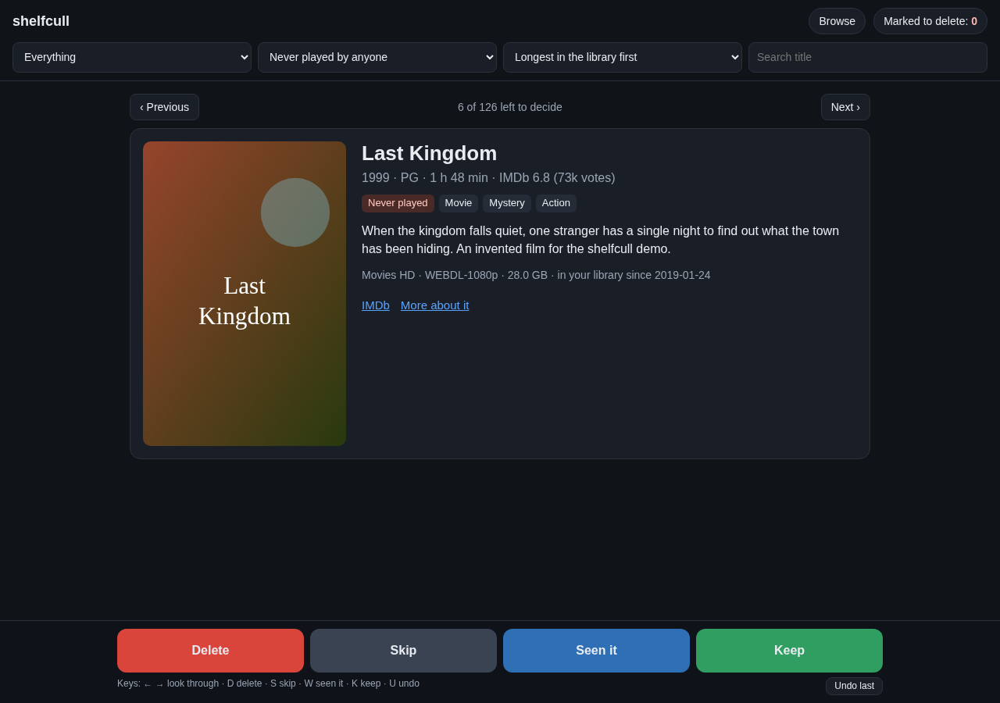
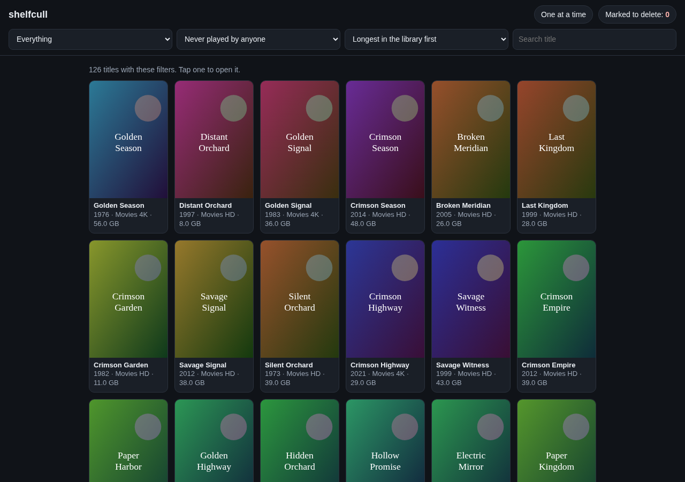
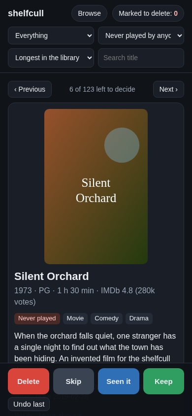

# shelfcull

Click through your Radarr and Sonarr libraries one title at a time, see who actually watched it in Plex, and mark it
**Delete** or **Keep**. When you are done, one button removes everything you marked, from Radarr / Sonarr and from
disk, and adds an exclusion so it is not downloaded again.

It is built for the library that grew faster than anyone watched it.



| Poster wall | On a phone |
|---|---|
|  |  |

*(Screenshots show the built-in demo with invented titles.)*

## What it does

- **One card per title**: poster, plot, year, rating, genres, size on disk, and a trailer / IMDb link, so you can decide
  about films you do not remember adding.
- **Watch state from Plex**: how often you played it, when, and which other users played it. Filter by
  *never played by anyone*, *never played by me*, *watched*, or everything.
- **Delete / Skip / Keep / Seen it**. *Seen it* marks the title as played in Plex, for things you watched somewhere else.
- **Import from IMDb**: upload your IMDb ratings (or any IMDb list) export and everything on it that is in your library
  is marked as played in Plex in one go.
- **Look without deciding**: Previous / Next, arrow keys, swipe on a phone, or a poster wall.
- **Several Radarr, Sonarr and Plex servers** at once. A film that is in both your HD and your 4K Radarr is removed from
  both.
- **TV shows** through Sonarr, removed as whole series; the card says how many episodes and GB that is, season by season.
- **Nothing is deleted until you press Remove** and confirm. A dry-run mode shows what would happen first.
- One small container, Python standard library only, no database. Your marks are a JSON file.

## Quick start (Docker)

```bash
git clone https://github.com/rhcp011235/shelfcull.git
cd shelfcull
cp .env.example .env        # then edit .env: URLs, API keys, a password
mkdir -p data
docker compose up -d --build
```

Or use the published image, `ghcr.io/rhcp011235/shelfcull:latest`, in place of `build: .`.

Open `http://<your-server>:8765/`.

`.env.example` starts with `DRY_RUN=true`, so the first Remove deletes nothing and only logs what it would do
(`docker logs shelfcull`). Set `DRY_RUN=false` and restart when you are happy.

Without compose:

```bash
docker build -t shelfcull .
docker run -d --name shelfcull -p 8765:8765 --env-file .env -v "$PWD/data:/data" shelfcull
```

The container runs as uid 1000. If your `data` folder belongs to someone else, add `user: "UID:GID"` in
`docker-compose.yml` (or `--user` on `docker run`).

## Quick start (no Docker)

Python 3.10 or newer, nothing to install:

```bash
cp .env.example .env        # edit it
python3 -m shelfcull
```

## Try it without touching your library

```bash
python3 tests/demo.py
```

starts fake Radarr / Sonarr / Plex servers with invented titles and shelfcull on `http://127.0.0.1:8765/`.

## Settings

Everything is an environment variable; `.env` in the working directory is read at start (`ENV_FILE` points somewhere else).

### Servers

| Variable | Meaning |
|---|---|
| `RADARR_1_URL`, `RADARR_1_API_KEY`, `RADARR_1_NAME` | A Radarr. Add `RADARR_2_...`, `RADARR_3_...` for more. `RADARR_URL` / `RADARR_API_KEY` without a number also works. |
| `SONARR_1_URL`, `SONARR_1_API_KEY`, `SONARR_1_NAME` | A Sonarr, same pattern. Optional. |
| `RADARR_1_RECYCLE_BIN`, `SONARR_1_RECYCLE_BIN` | Optional: the path where shelfcull can reach that instance's recycle bin (mount it into the container, writable). See *Undo* below. |
| `PLEX_1_URL`, `PLEX_1_TOKEN`, `PLEX_1_NAME` | A Plex Media Server, same pattern. Optional: without Plex you still get the cards, Delete and Keep, but no watch state and no *Seen it*. |

You need at least one Radarr or one Sonarr. Use the Plex **server owner's** token
([how to find it](https://support.plex.tv/articles/204059436-finding-an-authentication-token-x-plex-token/)):
"played by you" is the owner's watch state, other users' plays are read from the server's play history.

### Behaviour

| Variable | Default | Meaning |
|---|---|---|
| `AUTH_PASSWORD` | *(none)* | Password for the page (HTTP Basic). **Set it.** |
| `AUTH_USER` | `admin` | User name for the page. |
| `DRY_RUN` | `false` | `true`: Remove deletes nothing and logs what it would do. |
| `DELETE_FILES` | `true` | Delete the files too. `false` only removes the entry from Radarr / Sonarr. |
| `ADD_EXCLUSION` | `true` | Add an import list exclusion, so lists do not add the title again. |
| `ALL_INSTANCES` | `true` | Remove a title from every Radarr (or every Sonarr) that has it, and exclude it in all of them. `false`: only the instance you marked it in. |
| `PLEX_SCAN_AFTER_DELETE` | `true` | Ask Plex to scan its movie / TV libraries after a removal. |
| `PLEX_EMPTY_TRASH` | `false` | Empty the Plex trash of those libraries when the scan has finished. |
| `DEFAULT_VIEW` | `all` | What the page opens on when you have both films and TV: `all`, `movies` or `shows`. |
| `REFRESH_MINUTES` | `60` | How often the list is rebuilt. New downloads appear after a rebuild. |
| `LISTEN` / `PORT` | `0.0.0.0` / `8765` | Where the page listens. |
| `DATA_DIR` | `./data` (`/data` in Docker) | Where your marks, the cached list and the log are kept. |
| `HTTP_TIMEOUT` | `120` | Seconds to wait for Radarr / Sonarr / Plex. |
| `VERIFY_TLS` | `true` | `false` for servers behind a self-signed certificate. |

## How removal works

1. You mark titles. Marks are saved at once in `data/decisions.json`; nothing else happens.
2. *Marked to delete* shows the list and the total size. **Remove** asks for confirmation and queues the run.
3. For each marked title the worker checks that the title and year you saw still match what Radarr / Sonarr has under
   that id (if not, it is skipped and reported), removes its running downloads from the queue, then deletes it with
   `deleteFiles` and the import exclusion, in every instance that has it.
4. Plex is asked to scan, and the list is rebuilt.

**Undo:** whether a removed title can be brought back depends on *your* Radarr / Sonarr setup. If a recycle bin is set
there (Settings > Media Management > Recycling Bin), files go to it; without one they are deleted for good. The
exclusion can be removed under Settings > Import Lists > List Exclusions.

**Recycle bin dates:** Radarr and Sonarr empty their bin by each file's own date, so a film you have had for two years
is purged at the very next clean-up, not after the "keep N days" you set. If you give shelfcull the bin's path
(`RADARR_1_RECYCLE_BIN=/bins/radarr`, with the bin folder mounted there), it sets the removed files' date to the
moment of removal, so the keep period really counts from then.

## Import from IMDb

*Marked to delete* > **Import from IMDb**. On imdb.com open *Your ratings* (or a list), choose *Export*, and pick the
downloaded `.csv`. Every title in the file that is in your library and not yet played is marked as played in Plex.
"Only titles I rated" skips rows without your rating, which is what you want for a watchlist export. IMDb offers no
way to read your ratings automatically, so this is a file you upload when you want to catch up.

## Security

shelfcull can delete your library, so treat the page like the Radarr page itself:

- Set `AUTH_PASSWORD`. Do not expose the port to the internet; put it behind your VPN or an authenticating reverse proxy.
- API keys and tokens stay on the server. They are never sent to the browser, never written to the log, and never
  part of an error message.
- The browser loads posters directly from the image hosts Radarr / Sonarr point to (TMDB, TheTVDB), and nothing else
  from outside.
- Requests that change something must be same-origin JSON.

## Limits

- Watch state is matched by TMDB / IMDb / TVDB id. A title Plex has matched to something else shows as "Not found in Plex".
- TV shows are all-or-nothing: no per-season removal.
- "Played by you" means the Plex server owner. There are no per-user views.
- Jellyfin / Emby are not supported.

## Development

```bash
python3 -m unittest discover -s tests -v      # 22 tests against fake Radarr / Sonarr / Plex servers
tests/run_ui_test.sh                          # browser test of the page; needs node, playwright-core and a Chromium
```

`tests/fakes.py` holds the fake servers; `tests/demo.py` uses them for the demo.

## License

MIT. Not affiliated with Radarr, Sonarr or Plex.
